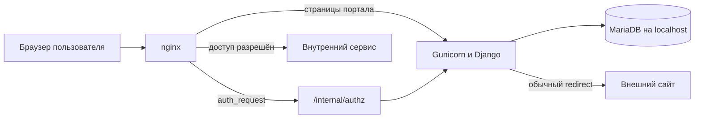
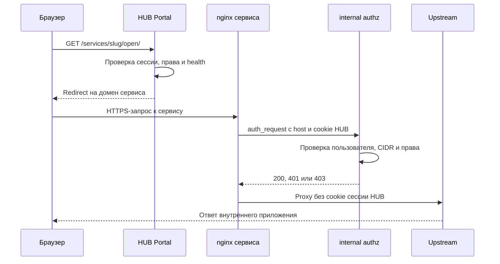

# Архитектура HUB Portal

## Общая схема



nginx является единственной публичной точкой входа. Gunicorn слушает Unix-сокет,
а MariaDB — только `127.0.0.1`. Браузер не подключается к ним напрямую.

## Компоненты

| Компонент | Назначение |
|---|---|
| nginx | TLS, HTTP, static, reverse proxy и вызов `auth_request` перед доступом к сервису. |
| Gunicorn | Запускает WSGI-приложение под системным пользователем `hubportal`. |
| Django | Авторизация, права, сессии, аудит, настройки и административный web-интерфейс. |
| MariaDB | Пользователи, сервисы, права, сессии, настройки и бизнес-аудит. |
| health monitor | Отдельный systemd-процесс, проверяющий upstream зарегистрированных сервисов. |
| certbot | Выпускает и обновляет сертификаты Let's Encrypt в domain-режиме. |
| systemd timers | Удаляют просроченные Django-сессии и старые записи аудита. |

## Поток входа

1. Браузер открывает `/`.
2. Django проверяет глобальный IP/CIDR-доступ.
3. Пользователь входит по логину и паролю либо по постоянному токену.
4. Django создаёт серверную сессию с фиксированным сроком 24 часа.
5. После входа пользователь переходит в `/services/`.
6. При обязательной смене временного пароля сначала открывается
   `/password/change-first/`.

## Поток открытия reverse proxy



Успешные внутренние API-запросы downstream-приложения не записываются в
бизнес-журнал HUB. Фиксируется один факт открытия карточки сервиса. Отрицательные
проверки прямого доступа могут фиксироваться как события безопасности.

## Типы сервисов

### Защищённый reverse proxy

HUB создаёт отдельный nginx-vhost, получает сертификат и проверяет каждый запрос
через `/internal/authz`. Upstream может иметь собственную форму входа: HUB не
подменяет внутреннюю авторизацию приложения.

### Внешняя ссылка

Карточка выполняет обычный redirect на внешний HTTPS/HTTP URL. После перехода
трафик не проходит через HUB и контролируется владельцем внешнего сайта.

## Основные данные

| Модель | Что хранит |
|---|---|
| `User` | Логин, ФИО, роль, password hash, токен входа и состояние учётки. |
| `Service` | Тип, домен или URL, upstream, health-check и nginx-опции. |
| `ServiceHealthState` | Текущий статус, счётчики успехов/ошибок и последнюю ошибку. |
| `ServiceRevision` | Снимки и итоговые nginx-конфиги при изменении сервиса. |
| `ServiceLayout` | Общую для всех пользователей раскладку карточек. |
| `UserSession` | Управляемые активные сессии, устройство, IP и срок действия. |
| `AuditEvent` | Нормализованные бизнес-события портала. |
| `PortalAccessRule` | Глобальный список разрешённых IP/CIDR. |
| `UserAccessRule` | Дополнительный IP/CIDR-список конкретного пользователя. |
| `PortalSecuritySettings` | Лимит ошибок входа и длительность блокировки. |
| `PortalVisualSettings` | Параметры particle-анимации страницы входа. |

## Файловая структура runtime

```text
/opt/hub-portal/
├── current -> releases/<release-id>
├── venv -> venvs/<release-id>
├── releases/                  неизменяемый код установленных версий
├── venvs/                     Python-окружение каждой версии
└── runtime/                   изменяемое служебное состояние

/etc/hub-portal/
├── hub-portal.env             секреты и параметры приложения
└── github.token               необязательный root-only token приватного fork
```

Приложение не хранит загружаемые пользователями файлы. Основное изменяемое
состояние находится в MariaDB и `/opt/hub-portal/runtime`.

## Релизная модель

Каждая версия получает собственные директории кода и venv. Обновление сначала
собирает новую версию, выполняет проверки, миграции и `collectstatic`, затем
переключает symlink `current` и `venv`. CSS/JS получают content hash; HTML и JSON
состояния релиза отдаются с `no-store`.

Код можно вернуть на предыдущий release. Миграции MariaDB назад автоматически не
выполняются, поэтому для полного rollback нужен соответствующий backup БД.

## Границы доверия

- внешнему `Host`, cookie и заголовкам браузера доверять нельзя;
- `/internal/authz` защищён внутренним shared key nginx/Django;
- только Django решает, кому разрешён сервис;
- upstream считается отдельной системой и может требовать собственный вход;
- DNS-запись без зарегистрированного nginx-vhost не публикует сервис через HUB;
- секреты, внутренние адреса и token plaintext не должны попадать во frontend.

Подробности: [модель защиты](SECURITY_MODEL.md).
